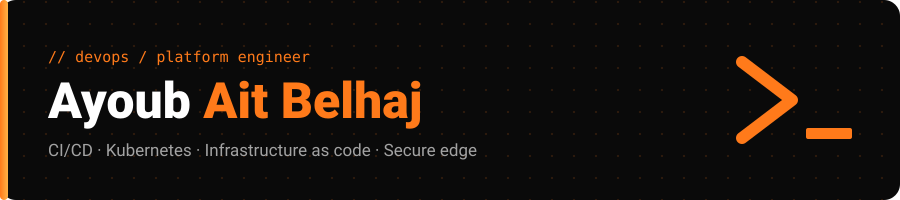

 

I build and run CI/CD pipelines, Kubernetes platforms and secure infrastructure as code. I own a production web platform end to end, and I trained as a systems engineer at **1337 (42 Network)**. Based in Morocco, open to relocation and remote roles.

**Stack:** `GitHub Actions` `Jenkins` `SonarQube` `Trivy` · `Docker` `Kubernetes` `Helm` `Argo CD` · `Terraform` `Ansible` `Azure` `AWS` · `Nginx` `Linux` · `Python` `Bash`

### Projects

- **[Inception-of-Things](https://github.com/aaitbelh/Inception-of-things-Devops-)**: K3s cluster with Vagrant, ingress routing and GitOps with Argo CD.
- **[cloud-1 on Azure](https://github.com/aaitbelh/Wordpress_Azure-Cloud-1-)**: Terraform builds the Azure network and VM, Ansible deploys the app.
- **[BADASS](https://github.com/aaitbelh/Bgp-At-Doors-of-Autonomous-Systems-is-Simple)**: VXLAN network lab with GNS3 and Docker.

### Contact

[Portfolio](https://aaitbelh.github.io) · [LinkedIn](https://www.linkedin.com/in/aitbelhaj-ayoub-799515241) · [aitbelhajayoub566@gmail.com](mailto:aitbelhajayoub566@gmail.com)
