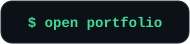
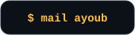

 

I run the delivery and runtime platform for a production web application: CI/CD with security gates, containers on Kubernetes, a hardened TLS edge, object storage, and everything provisioned as code. My systems background comes from **1337 (42 Network)**, where I built clusters, cloud deployments and low-level security tooling from scratch. Based in Morocco, open to relocation and remote roles.

## ⚙️ How I ship

Every change passes tests, a SonarQube quality gate and a Trivy scan before staged promotion.

## 🧰 Toolbox

## 🚀 Featured projects

<table>
  <tr>
    <td></td>
    <td></td>
  </tr>
  <tr>
    <td></td>
    <td></td>
  </tr>
</table>

## 🛠️ What I do day to day

- **Delivery pipelines:** GitHub Actions and Jenkins with automated tests, SonarQube quality gates, Trivy image and dependency scans, and promotion through test, staging and production.
- **Platform:** Next.js, Prisma, PostgreSQL and Redis workers as Docker services on a K3s cluster, with deployments, rollbacks and environment configuration.
- **Edge and security:** Nginx reverse proxy, automated Let's Encrypt TLS, rate limiting and security headers.
- **Reliability:** S3-compatible storage (SeaweedFS, MinIO) and tracing faults across the network, storage and application layers.
- **Infrastructure as code:** Terraform and Ansible so staging and production stay reproducible.
- **Team:** supervising interns, code review, runbooks and documentation.

The production code is private. The projects above are public work that shows the same practices. More at **[aaitbelh.github.io](https://aaitbelh.github.io)**.

Reach me at <a href="mailto:aitbelhajayoub566@gmail.com">aitbelhajayoub566@gmail.com</a>

